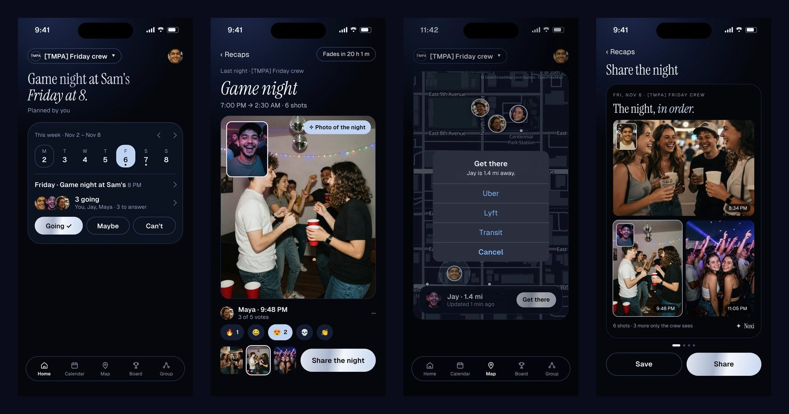
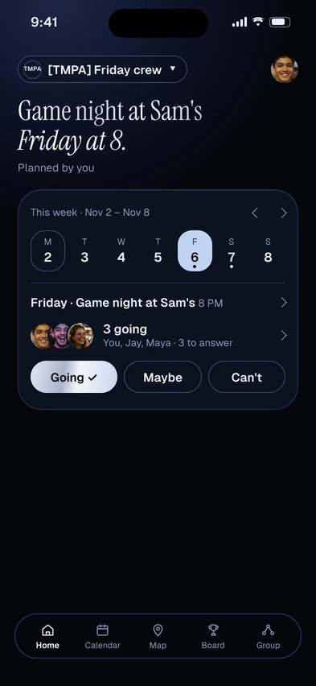
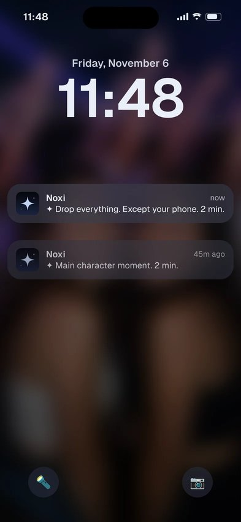
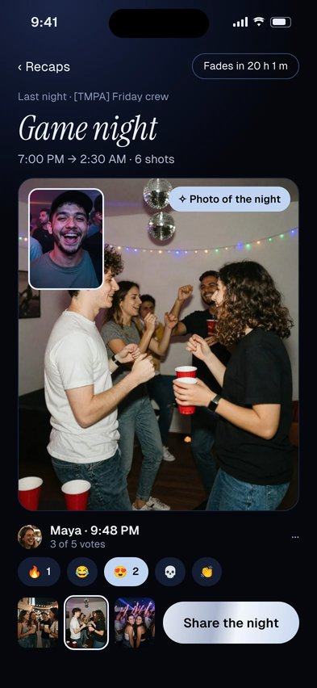
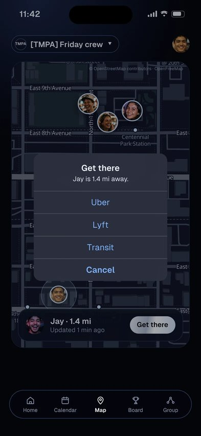
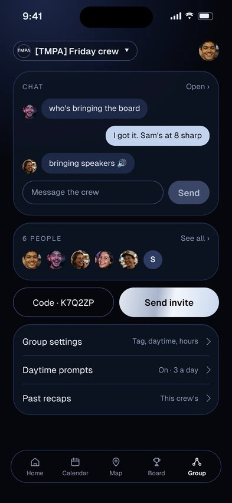
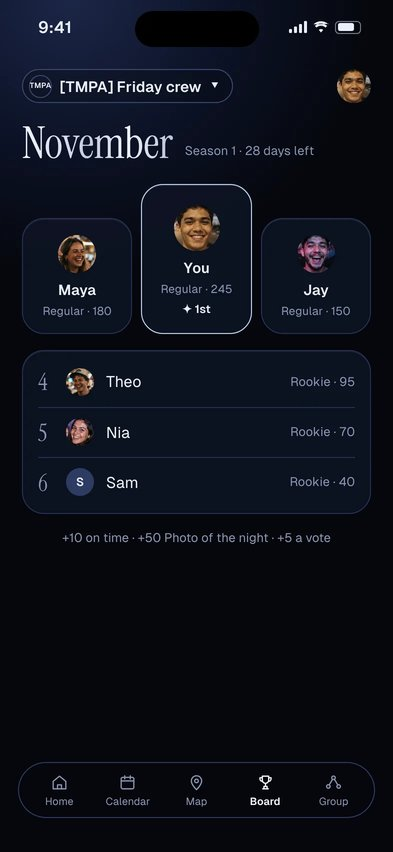
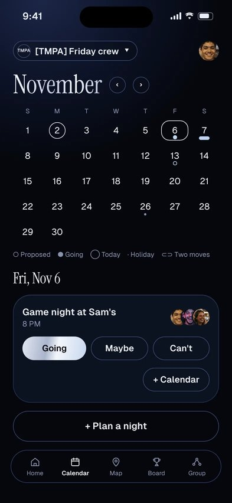
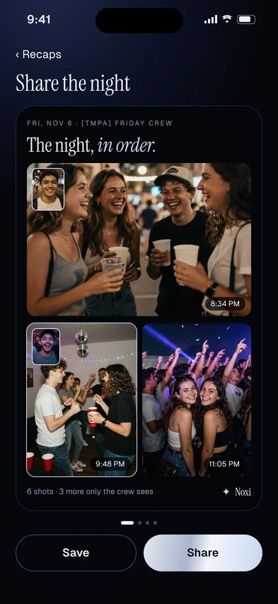

<h1 align="center">Noxi: Case Study</h1>

<b>A private photo app for friend groups on nights out.</b> 
Live in TestFlight beta · <a href="https://appnoxi.com"><b>appnoxi.com</b></a>

> The Noxi source code is private. This page shows the product and how I built it.
> I can share read-only code access with interviewers on request.

[← Back to all projects](../README.md)

---

## At a glance

| | |
|---|---|
| **My role** | Founder and product builder. I planned the product, wrote the specs, directed AI coding agents in Claude Code, and tested every build on my iPhone. |
| **Status** | Live in TestFlight beta, 20 builds shipped |
| **Platform** | iPhone (Android uses the same code) |
| **Stack** | Expo (React Native), TypeScript, Expo Router, Supabase, Expo push notifications, EAS Build, MapLibre maps |
| **Website** | [appnoxi.com](https://appnoxi.com) |

## The problem

Friend groups take hundreds of photos on a night out.
Most of those photos stay on one person's phone.
The next morning, nobody has the full story of the night.

## The idea

Noxi sends random alerts to everyone in the group during the night.
Each alert gives a 2-minute window for one photo or one 5-second video.
Each morning, the group gets a recap of the night, called "the chronicle."

## The app

<table>
<tr>
<td align="center" width="25%"> <b>Home</b> Plan the night and see who is going.</td>
<td align="center" width="25%"> <b>Prompts</b> Random alerts with a 2-minute window.</td>
<td align="center" width="25%"> <b>The chronicle</b> The morning recap, with votes for the photo of the night.</td>
<td align="center" width="25%"> <b>Live map</b> See where friends are and get there.</td>
</tr>
<tr>
<td align="center"> <b>Group</b> Chat, invite codes and group settings.</td>
<td align="center"> <b>Board</b> XP and a monthly season for each group.</td>
<td align="center"> <b>Calendar</b> Plan nights with Going, Maybe and Can't.</td>
<td align="center"> <b>Share</b> Save or share the night in order.</td>
</tr>
</table>

## What I built

- **Accounts:** sign-up and login with an 18+ age check, plus a tutorial that asks for camera and alert access at the right step.
- **Groups:** group tags, invite links and codes, and one-night party passes.
- **Night planning:** up to 3 stops, Going / Maybe / Can't replies, and reminders.
- **Prompts:** random alerts from the start of the night until 4 AM. They stop when someone is home or charging their phone.
- **The chronicle:** a morning recap with awards voting and XP.
- **Live map:** friends on a map, plus "I'm home" check-ins.
- **Themes:** eight looks for the app, with a fixed night theme for the camera and map.
- **Noxi+:** an optional paid plan with extras. Free features stay free.

## How I built it

- **AI-assisted development.** I wrote a product brief, a design system and a step-by-step build plan. Claude Code built one small, testable feature per session from that plan.
- **No Mac needed.** I build the iPhone app in the cloud with EAS Build and test it on my own iPhone.
- **Fast updates.** Small fixes reach testers over the air, with no new App Store build.
- **Every decision written down.** I logged 95 product and technical decisions with dates and reasons.

## Hard problems I solved

- **Privacy:** Photos stay on the server for a short time, then delete 24 hours after the night ends.
- **Security:** Every database table uses Supabase row-level security, so users only see their own groups.
- **Old builds keep working:** Database changes only add columns and tables. Nothing old is renamed or removed, so testers on older builds never break.
- **App Store rules:** The app never tracks drinks or encourages drinking, which follows Apple guideline 1.4.3.

---

Built by <b>Philip Werner</b> ("Cohesive") · © 2026 Philip Werner. All rights reserved. 
<a href="https://appnoxi.com">appnoxi.com</a> · <a href="../README.md">All projects</a>

